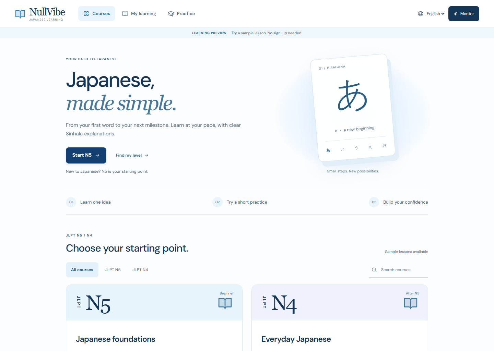
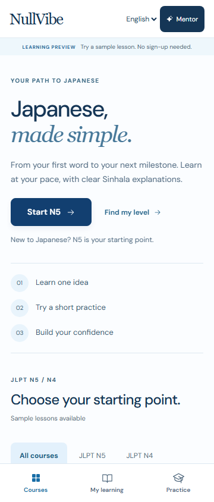
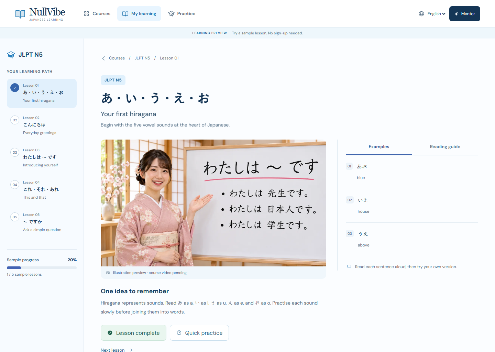
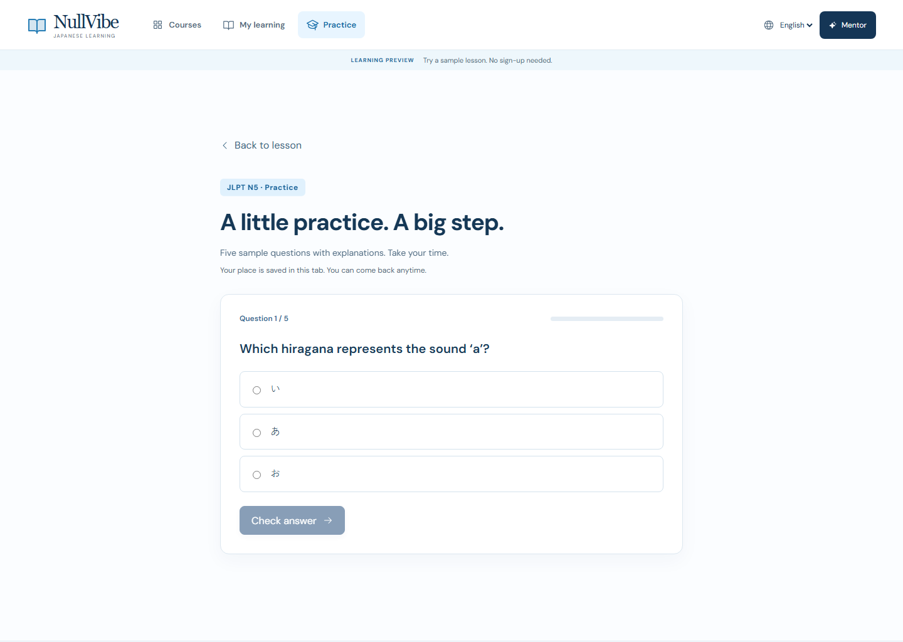
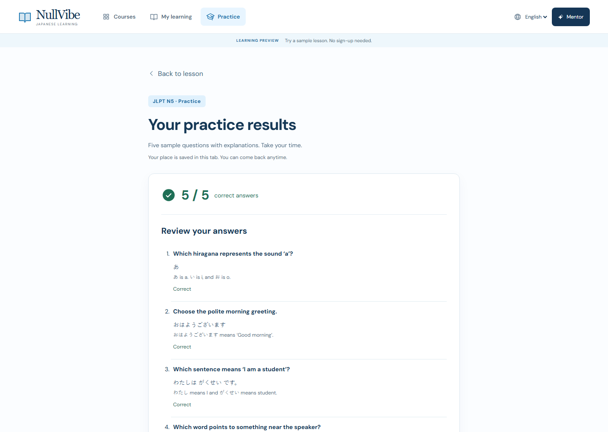
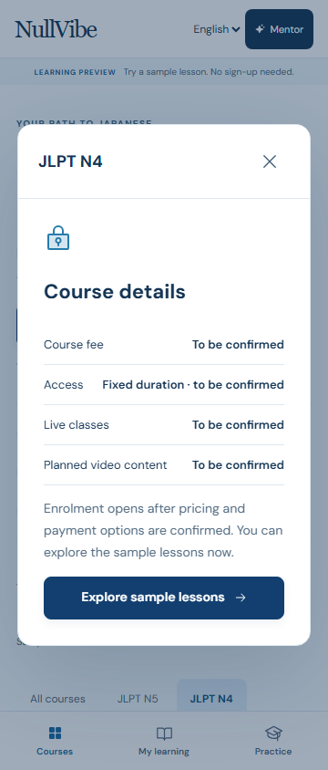
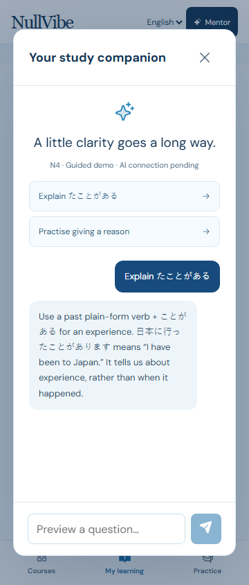
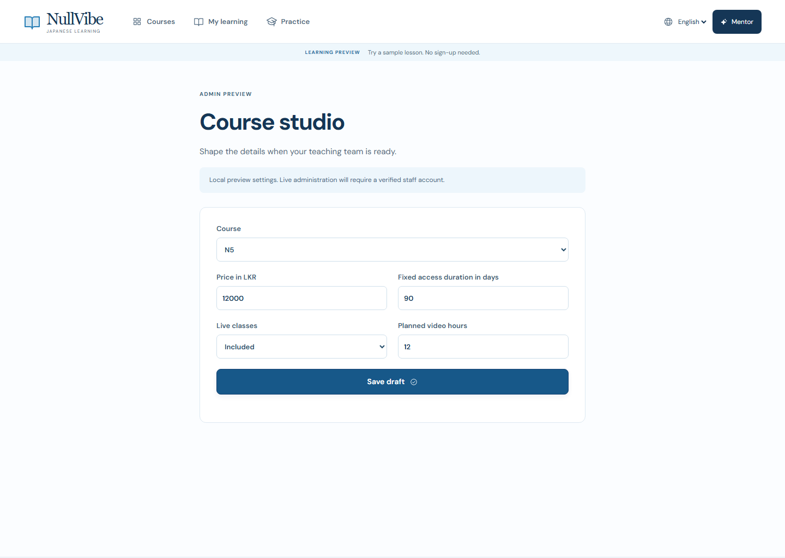
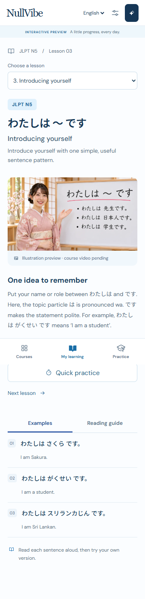
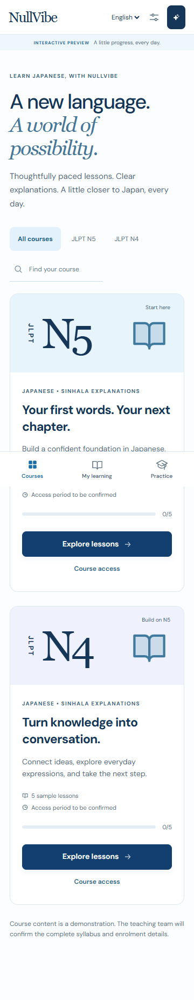

# NullVibe UI/UX audit and fixes

13 November 2026 · hosted learning preview at https://nullvibe-japanese-lms.vercel.app · English by default, Sinhala and Japanese selectable. Screenshots were refreshed from the live release.

The revised experience explains where to begin, gives learners a consistent route through lessons and practice, and keeps staff tools out of the primary learner navigation. The white/light-blue visual direction and selected lesson workspace remain intact. A lightweight hiragana card adds visual character to the desktop welcome screen; mobile prioritizes the starting action.

## 1. Arrival and course selection — ready for prototype review

Previously a new visitor landed at N5 lesson 03 without an introduction. Course headlines were abstract and the first mobile course action required substantial scrolling. The new default is course discovery with a visible Start N5 action, Beginner / After N5 labels, a three-step learning explanation and a Find my level shortcut. Search now matches descriptions as well as titles, and empty results have a reset action.

## 2. Learning — ready for prototype review

New learners start at the first incomplete lesson. A validated, per-course position resumes the last selected lesson. The lesson workspace retains the sidebar, teacher illustration and examples/reading-guide tabs. Mobile exposes the same lessons through a labeled selector and shows completion count. Courses is a visible return action. Browser Back/Forward, refresh and course-specific links work.

The illustration is labeled; it is not playable course video. Sample lesson explanations are functional, but teacher approval of content and translations remains necessary.

## 3. Practice — ready for prototype review

The five-question flow prevents checking an empty answer and provides explanations after each choice. A validated draft saves the question, selection and checked state within the tab. Leaving and returning, or refreshing, retains the attempt. If storage is blocked, the UI explains that saving is unavailable.

## 4. Results and review — ready for prototype review

Results show the score, correct answers and explanations, with Continue learning and Try again actions. Perfect and all-wrong attempts are covered. Completed results survive refresh. Invalid saved scores are rejected before rendering.

## 5. Course details — ready as an information preview

Fee, fixed access duration, planned live classes and video hours reflect the configurable draft. Unknown values remain explicitly unconfirmed. Sample lessons are accessible through the dialog; paid enrolment is not active. The dialog locks background scrolling, keeps keyboard focus inside, restores focus on close, supports Escape, and only closes on an actual outside click.

## 6. Mentor — ready as a guided demonstration

N4 now offers N4 examples instead of repeating the N5 prompts. Prepared explanations are labeled, the empty state explains how to begin, and a free-form question receives an honest connection-pending response. Submitted text is rendered as text, and the retained conversation is bounded. No question is sent to an AI provider.

## 7. Staff configuration — ready as a local preview

A labeled Staff preview link in the footer replaces the unlabeled settings icon in the learner header. Price, access days, live-class choice and media hours are editable and validated. Confirmation distinguishes a saved draft from changes that cannot be saved by the browser. These settings affect only this browser; they do not administer a production system.

The numeric settings in this screenshot are test inputs, not agreed course pricing or duration. Fresh browser defaults remain unconfirmed.

## Accessibility and loading improvements

- Semantic navigation links, current-page state, a working skip link, visible focus, keyboard tabs and explicit form labels.
- Dialog Tab/Shift+Tab wrapping, Escape and return focus; narrow/short viewport interaction checks.
- Short transitions preserve text opacity, and reduced-motion preferences remove the movement.
- Local licensed Latin/Sinhala fonts remove the remote stylesheet dependency. Japanese uses system fonts. The preview still works when font loading fails.
- A 69,224-byte WebP illustration loads on the lesson screen. No background video or animation framework is required.

The checks and actual test counts are in [QA.md](../QA.md), with machine-readable results in [results.json](../qa/results.json), [quality.json](../qa/quality.json) and [hosted smoke results](../qa/hosted/results.json). Automated scans are evidence for tested rules, not a full accessibility certification. Screen-reader sessions, physical iOS/Android devices, teacher review, and production services remain outside this frontend audit.

## Captured baseline

The baseline was captured from the current checkout before this revision, at 360 and 1440 pixels. Original arrival and course-selection evidence:

Full-page baseline screenshots show fixed navigation at the capture viewport boundary; that artifact is not evidence of a permanent overlap. Final screenshots use viewport captures after resetting scroll and allowing animations to finish.
